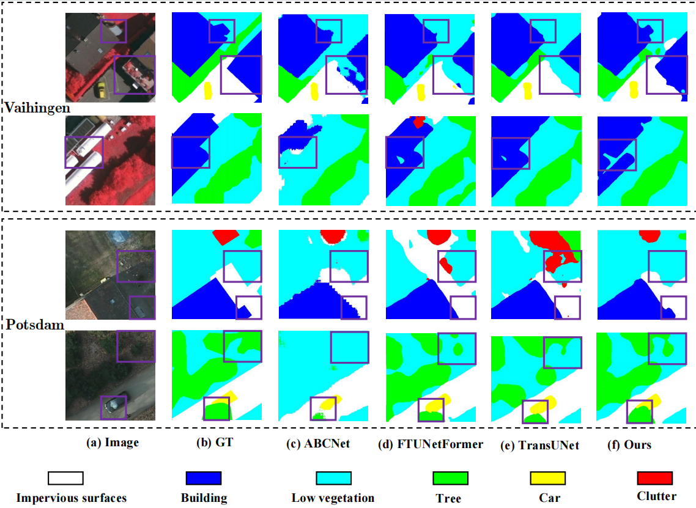

# Lightweight Semantic Segmentation for Low-Altitude UAV Scenes via Dual-Offset Self-Correction and Weighted Guided Supervision

Official PyTorch implementation of **LADS-Net** for UAV / aerial semantic segmentation.


**LADS-Net** is a lightweight semantic segmentation network designed for resource-constrained low-altitude UAV scenarios. It integrates a Lightweight Multi-Scale Decoder (LMSD) for multi-scale feature refinement, a Dual Offset Self-Correction Module (DOSM) for input-adaptive alignment between spatial features and class semantics, and a Weighted Guided Supervision Strategy (WGSS) for cross-scale supervision during training. As WGSS is discarded during inference, it introduces no additional inference overhead.


## 📢 News

- **2026-09:** Code of LADS-Net is released.


## 🖼️ Qualitative Results


### Cross-domain generalization (ISPRS)



## 🛠️ Setup


### 💻 Dependencies

```bash
conda create -n ladsnet python=3.10 -y
conda activate ladsnet
pip install -r requirements.txt
```


### ⬇ Pretrained encoder

Download **PVTv2-B2** from [PVTv2](https://github.com/whai362/PVT) and place it in:

```text
pretrained_pth/pvt/pvt_v2_b2.pth
```


### 📂 Data layout

```text
data/<dataset>/
├── train/{images,masks}/
└── val/{images,masks}/
```


## 📊 Datasets & Splits
Five low-altitude drone datasets are used for the main experiments, while the ISPRS dataset is employed for cross-platform generalization.


| Dataset              |     dataset      | #Classes | crop         |
| -------------------- | ---------------- | -------- | ------------ |
| UAVid                | `uavid`          | 8        | 512×512      |
| VDD                  | `vdd`            | 7        | 512×512      |
| AeroScapes           | `aeroscapes`     | 12       | 512×512      |
| UDD5                 | `udd5`           | 5        | 512×512      |
| Semantic Drone (SDD) | `semantic_drone` | 24       | 512×512      |
| ISPRS Vaihingen      | `vaihingen`      | 6        | 256×256      |
| ISPRS Potsdam        | `potsdam`        | 6        | 256×256      |


## ⚙️ Experiment Configuration

Unless otherwise specified, the main experiment follows a unified protocol.

### Hardware & framework


| Item         | Setting                          |
| ------------ | -------------------------------- |
| Framework    | PyTorch                          |
| GPU          | 1× NVIDIA L40S                   |
| Encoder init | ImageNet-pretrained **PVTv2-B2** |


### Optimization


| Item                     | Setting                   |
| ------------------------ | ------------------------- |
| Optimizer                | AdamW                     |
| Initial learning rate    | `1e-4`                    |
| Weight decay             | `1e-4`                    |
| LR schedule              | Cosine annealing → `1e-6` |
| Epochs                   | **150**                   |
| Batch size               | **4**                     |
| Input resolution (UAV)   | **512×512**               |
| Input resolution (ISPRS) | **256×256**               |


## 🏷️ Evaluating

```bash
python val.py \
  --data_dir [YOUR_DATA_DIR] \
  --dataset {dataset} \
  --model LADS_Net \
  --model_path {model weights}
```


## 🧪 Training

```bash
python train.py \
  --data_dir [YOUR_DATA_DIR] \
  --dataset {dataset} \
  --model LADS_Net \
  --encoder pvt_v2_b2 \
  --encoder_pretrain_path ./pretrained_pth/pvt/pvt_v2_b2.pth \
  --batch_size 4 \
  --epochs 150 \
  --lr 1e-4 \
  --optimizer adamw \
  --scheduler cosine \
  --input_w 512 \
  --input_h 512 \
  --name {dataset}_LADSNet
```

ISPRS（256×256）：

```bash
python train.py \
  --data_dir [YOUR_DATA_DIR] \
  --dataset {dataset} \
  --model LADS_Net \
  --encoder pvt_v2_b2 \
  --encoder_pretrain_path ./pretrained_pth/pvt/pvt_v2_b2.pth \
  --batch_size 4 \
  --epochs 150 \
  --input_w 256 \
  --input_h 256 \
  --name vaihingen_LADSNet
```

