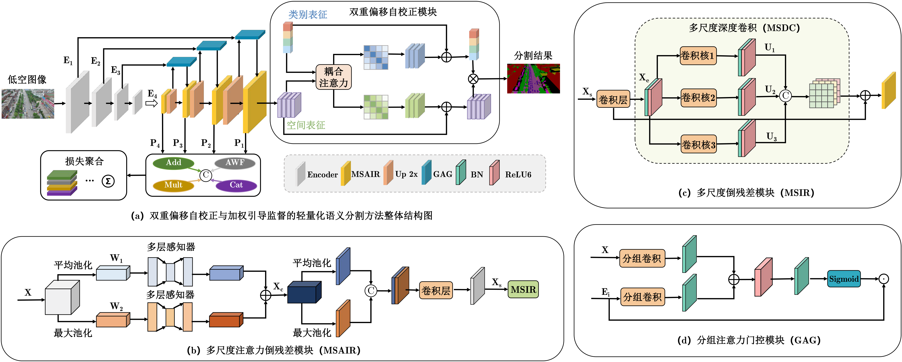

# 低空场景下双重偏移自校正与加权引导监督的轻量化语义分割方法

Official PyTorch implementation of **LADS-Net** for UAV / remote-sensing semantic segmentation, with **DOSC** (Dual Offset Self-Correction) and **WGS** (Weighted Guided Supervision).

---




## 📢 News

- `[2026.9]` Code of LADS-Net is released!

---

## 🛠️ Setup

```bash
# create a new environment with conda
conda create -n ladsnet python=3.10
conda activate ladsnet
# install requirements
pip install -r requirements.txt
```

Put PVTv2-B2 weights at:

```text
pretrained_pth/pvt/pvt_v2_b2.pth
```

---

## 🏷️ Evaluating

```bash
python val.py --data_dir [YOUR_DATA_DIR] --dataset {dataset} --model_path {model weights}
```

Supported datasets: `uavid`, `vdd`, `aeroscapes`, `udd5`, `semantic_drone`, `vaihingen`, `potsdam`.

---

## 🧪 Training

```bash
python train.py \
  --data_dir [YOUR_DATA_DIR] \
  --dataset {dataset} \
  --model LADS_Net \
  --encoder pvt_v2_b2 \
  --encoder_pretrain_path ./pretrained_pth/pvt/pvt_v2_b2.pth \
  --batch_size 4 \
  --epochs 150 \
  --name {dataset}_LADSNet
```
